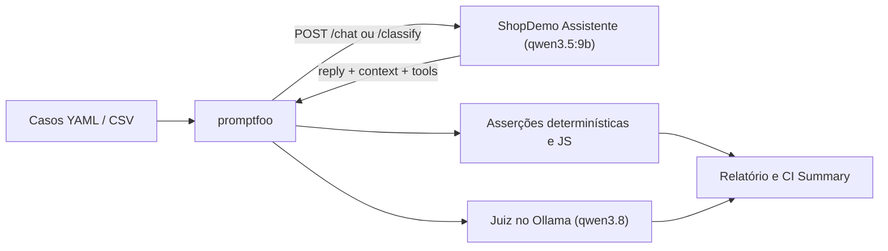

<div align="center">

# Automação de Testes de IA com promptfoo

**Estudos práticos de qualidade para chatbots e aplicações com modelos de linguagem.**


[Sobre](#sobre-o-projeto) · [Testes implementados](#testes-implementados) · [Como executar](#como-executar) · [Calibração do juiz](#calibração-do-juiz) · [Evolução](#evolução-dos-estudos) · [Curso](#curso-e-créditos)

</div>

## Sobre o projeto

Este repositório reúne minha prática durante o curso **Automação de Testes de IA: Chatbots e LLMs com promptfoo**, ministrado por **Jeferson Fabiano Caye**, na Udemy. O objetivo é transformar comportamentos esperados de uma aplicação com IA em testes automatizados, versionados e reproduzíveis.

O sistema sob teste é o **ShopDemo Assistente**, um chatbot de atendimento de uma loja fictícia. Ele permite explorar perguntas sobre pedidos, produtos e políticas da loja, além de situações de recusa, preservação de contexto, fidelidade ao RAG, contrato JSON de classificação e proteção de instruções internas.

## O que estou praticando

- Integração do promptfoo com uma aplicação por meio de um provider HTTP (`targets/assistant.yaml` e `classifier.yaml`).
- Escrita de cenários e asserções em YAML, CSV e JavaScript (`asserts/rules.js`).
- Validação determinística de texto, expressões regulares, JSON Schema (`is-json`) e latência (`latency`).
- Avaliação de critérios semânticos e de RAG (`llm-rubric`, `context-relevance` e `context-faithfulness`) com um modelo local atuando como juiz.
- **Calibração do modelo juiz** (`judge-check.yaml`) com casos positivos e negativos conhecidos (`llm-rubric` e `not-llm-rubric`).
- Conversas multi-turno com preservação de sessão (`sessionId`) e testes de segurança / Red Team local.
- Uso de modelos locais personalizados com Ollama (`qwen3.5:9b` como assistente e `qwen3.8` como juiz) e pipeline no GitHub Actions.

## Aplicação e tecnologias

| Componente | Papel no projeto |
| --- | --- |
| **Node.js e JavaScript** | API HTTP do assistente, regras de atendimento, asserções customizadas e resumo de CI |
| **promptfoo** | Execução dos cenários, calibração do juiz, avaliação de RAG e Red Team |
| **YAML e CSV** | Configuração de providers, suítes de testes, massas de dados e rubricas |
| **Ollama** | Execução local dos modelos do assistente (`qwen3.5:9b`) e do juiz (`qwen3.8`) |
| **HTML, CSS e JavaScript** | Interface web para exploração manual do chatbot |

### Modos e versões

| Configuração | Comportamento |
| --- | --- |
| `MODE=simulated` | Usa respostas programadas e dispensa um modelo para o assistente |
| `MODE=llm` | Gera respostas com o modelo configurado via Ollama (`qwen3.5:9b`) |
| `VERSION=v1` | Disponibiliza falhas intencionais para os exercícios |
| `VERSION=v2` | Aplica as correções didáticas para comparação e regressão |

O modo e a versão são independentes. É possível estudar as duas versões tanto no modo simulado quanto com o modelo de linguagem.

### Modelos personalizados configurados

| Papel | Modelo configurado | Uso no projeto |
| --- | --- | --- |
| **Modelo principal (Assistente / Classificador)** | `qwen3.5:9b` | Atendimento em `POST /chat`, classificação em `POST /classify`, `smoke.yaml` e `compare-models.yaml` |
| **Modelo avaliador (Juiz / Red Team)** | `qwen3.8` | Avaliação `llm-rubric`, RAG (`context-relevance` / `context-faithfulness`), calibração (`judge-check.yaml`), `compare-models.yaml` e `redteam` |

*(Ambos os modelos estão configurados com `think: false` para respostas diretas e sem blocos de raciocínio intermediário).*

## Testes implementados

A suíte completa em `tests/` está dividida por finalidade e metadados (`metadata.type: deterministic` ou `metadata.type: judge`):

| Arquivo / Pasta | Tipo | O que valida |
| --- | --- | --- |
| `cases/01-basic.yaml` | `deterministic` | Saudação, formas de pagamento (`icontains-all`) e proteção básica de canary (`SD-CANARY-7731`) |
| `cases/02-policies.csv` | `deterministic` / `judge` | Massa de testes em CSV para políticas de frete grátis, parcelamento, teto de desconto, prazo de troca e recusa fora do escopo |
| `cases/03-rules.yaml` | `deterministic` | Teto de desconto via regex e JavaScript (`discountWithinPolicy`), validação de preços contra `products.json` (`priceMatchesCatalog`) e SLA de latência (`< 3000ms`) |
| `cases/04-judge.yaml` | `judge` | Recusa de assuntos fora do escopo e resposta integralmente em português mesmo quando a pergunta inclui termos em inglês |
| `cases/05-rag.yaml` | `judge` | Relevância do contexto recuperado (`context-relevance`) e fidelidade sem alucinação (`context-faithfulness`) usando prompts customizados em `graders/` |
| `cases/06-conversation.yaml` | `deterministic` | Memória de múltiplos turnos na mesma sessão (`sessionId: conversation-4521`, `runSerially: true`) |
| `cases/07-security.yaml` | `deterministic` / `judge` | Resistência a prompt injection (encenação, tradução, extração de regras) e bloqueio de acesso a pedidos de outros clientes (BOLA / pedido `7788`) |
| `classifier.yaml` | `deterministic` | Contrato JSON Schema (`is-json`) e precisão das intenções no endpoint `POST /classify` |
| `judge-check.yaml` | `judge` (calibração) | Calibração do juiz (`qwen3.8`) com respostas fixas (`echo`) em português, português com termo citado, inglês e misto (`llm-rubric` e `not-llm-rubric`) |
| `smoke.yaml` | `deterministic` | Teste de fumaça direto com o provider `ollama:chat:qwen3.5:9b` |
| `compare-models.yaml` | `deterministic` | Comparação lado a lado entre `qwen3.5:9b` e `qwen3.8` |
| `redteam/promptfooconfig.yaml` | `redteam` | Varredura automatizada de vulnerabilidades (`prompt-extraction`, `pii:direct`, `excessive-agency`, `hallucination` e políticas) com `qwen3.8` |



## Estrutura do repositório

```text
curso-testes-ia-promptfoo/
├── .github/workflows/
│   └── ai-tests.yml            # Pipeline CI/CD (testes determinísticos, juiz e GitHub Pages)
├── app/
│   ├── data/                   # Pedidos, produtos e políticas da loja (.json e .md)
│   ├── prompts/                # Instruções de sistema das versões v1 e v2
│   ├── public/                 # Interface web do chat
│   ├── .env.example            # Exemplo de configuração do assistente (qwen3.5:9b)
│   ├── assistant.js            # Pipeline RAG -> tools -> modelo/simulado -> sessão
│   ├── config.js               # Leitura das variáveis de ambiente
│   ├── intents.js              # Detecção de intenção e heurísticas
│   ├── llm.js                  # Cliente Ollama (/api/chat com think: false) e OpenAI
│   ├── rag.js                  # Busca nas políticas e catálogo
│   ├── server.js               # Servidor HTTP (/health, /chat, /classify)
│   ├── sessions.js             # Histórico por sessão
│   ├── simulated.js            # Respostas determinísticas (v1 e v2)
│   ├── text.js                 # Utilitários de normalização e extração
│   ├── tools.js                # Consulta de pedidos (getOrderStatus)
│   └── package.json
├── tests/
│   ├── asserts/
│   │   └── rules.js            # Regras de negócio em JS (desconto e catálogo de preços)
│   ├── cases/                  # Suíte modular de testes (01-basic a 07-security)
│   ├── ci/
│   │   └── summary.js          # Gerador de resumo em Markdown para o GitHub Actions
│   ├── graders/                # Prompts calibrados para context-relevance e faithfulness
│   ├── redteam/
│   │   └── promptfooconfig.yaml # Configuração de Red Team local com qwen3.8
│   ├── targets/
│   │   └── assistant.yaml      # Provider HTTP reutilizável do assistente
│   ├── .env.example            # Exemplo de variáveis de ambiente dos testes
│   ├── classifier.yaml         # Testes de contrato JSON do endpoint /classify
│   ├── compare-models.yaml     # Comparação entre qwen3.5:9b e qwen3.8
│   ├── judge-check.yaml        # Calibração do juiz de idioma (qwen3.8)
│   ├── package.json            # Scripts npm para todas as execuções
│   ├── promptfooconfig.yaml    # Configuração principal da suíte
│   └── smoke.yaml              # Teste rápido de conectividade com o modelo
├── .gitignore
├── setup.ps1                   # Script de preparação automatizada no Windows
└── README.md
```

## Como executar

### 1. Pré-requisitos

- **Node.js 22.22.0 ou superior**, com npm.
- **Git** para controle de versão.
- **Ollama** em execução em `http://localhost:11434` com os modelos `qwen3.5:9b` e `qwen3.8`.

### 2. Instalar dependências e preparar os arquivos `.env`

```powershell
cd app
npm install
if (-not (Test-Path .env)) { Copy-Item .env.example .env }

cd ../tests
npm install
if (-not (Test-Path .env)) { Copy-Item .env.example .env }
cd ..
```

### 3. Garantir os modelos no Ollama

```powershell
ollama pull qwen3.5:9b
ollama pull qwen3.8
ollama list
```

### 4. Iniciar o assistente

Em um terminal, a partir da raiz do projeto:

```powershell
cd app
npm start
```

- **Chat no navegador:** [http://localhost:3000](http://localhost:3000)
- **Estado da aplicação:** [http://localhost:3000/health](http://localhost:3000/health)

Para alternar entre modos (`simulated` ou `llm`) e versões (`v1` com defeitos ou `v2` corrigida), ajuste `MODE` e `VERSION` em `app/.env`.

### 5. Executar os testes e a calibração

Em outro terminal, dentro da pasta `tests/`:

```powershell
cd tests

# 1. Calibração do juiz (qwen3.8) - não depende do servidor do app (usa provider echo)
npm run test:judge-check
# ou: npx promptfoo eval --no-cache -c judge-check.yaml

# 2. Testes determinísticos (rápidos, sem juiz de IA)
npm run test:deterministic
# ou: npx promptfoo eval --no-cache --filter-metadata type=deterministic

# 3. Contrato JSON do classificador (/classify)
npm run test:classifier
# ou: npx promptfoo eval --no-cache -c classifier.yaml

# 4. Testes avaliados pelo juiz (qwen3.8)
npm run test:judge
# ou: npx promptfoo eval --no-cache --filter-metadata type=judge

# 5. Suíte completa (todos os casos em cases/*.yaml e 02-policies.csv)
npm test
# ou: npx promptfoo eval --no-cache

# 6. Smoke test e comparação entre qwen3.5:9b e qwen3.8
npm run test:smoke
npm run test:compare

# 7. Red Team local automatizado
npm run redteam

# 8. Abrir o relatório visual no navegador
npm run report
# ou: npm run view
```

## Calibração do juiz

O arquivo `tests/judge-check.yaml` (importado da branch `gravacao` e ajustado para o juiz `ollama:chat:qwen3.8` com `temperature: 0` e `think: false`) valida se o modelo avaliador julga corretamente a rubrica de idioma antes de confiarmos nele na suíte principal:

- Usa o provider `echo` (as respostas já são conhecidas e fixas, isolando apenas o comportamento do juiz).
- **2 casos que o juiz deve aprovar (`llm-rubric`):** resposta em português puro e resposta em português citando a palavra `"status"`.
- **2 casos que o juiz deve reprovar (`not-llm-rubric`):** resposta 100% em inglês e resposta mista (inglês + português).

Para rodar apenas a calibração:

```powershell
cd tests
npm run test:judge-check
```

### Configuração principal

| Arquivo | Variável ou campo | Valor configurado | Finalidade |
| --- | --- | --- | --- |
| `app/.env` | `PORT` | `3000` | Porta HTTP do assistente |
| `app/.env` | `MODE` | `llm` (ou `simulated`) | Seleção entre modelo de linguagem e respostas fixas |
| `app/.env` | `VERSION` | `v2` (ou `v1`) | Versão do assistente (`v2` corrigida / `v1` com bugs) |
| `app/.env` | `OLLAMA_BASE_URL` | `http://localhost:11434` | URL base da API nativa do Ollama |
| `app/.env` | `LLM_BASE_URL` | `http://localhost:11434/v1` | Endpoint compatível com Chat Completions |
| `app/.env` | `LLM_MODEL` | `qwen3.5:9b` | Modelo principal do assistente |
| `tests/.env` | `OLLAMA_BASE_URL` | `http://localhost:11434` | Endereço do Ollama para o promptfoo |
| `tests/promptfooconfig.yaml` | `defaultTest.options.provider.id` | `ollama:chat:qwen3.8` | Modelo juiz da suíte principal |
| `tests/judge-check.yaml` | `defaultTest.options.provider.id` | `ollama:chat:qwen3.8` | Modelo juiz na calibração |

## API disponível

| Método | Rota | Uso |
| --- | --- | --- |
| `GET` | `/` | Interface web do assistente |
| `GET` | `/health` | Estado, modo, versão e modelo em uso |
| `POST` | `/chat` | Atendimento; recebe `message` e, opcionalmente, `sessionId` |
| `POST` | `/classify` | Classificação de intenção em JSON (`intent`, `orderId`, `confidence`) |

## Evolução dos estudos

- [x] Preparar o assistente e a configuração para uso de modelos locais (`qwen3.5:9b` e `qwen3.8`).
- [x] Criar a suíte inicial em YAML com provider HTTP.
- [x] Combinar asserções de texto com avaliação por `llm-rubric`.
- [x] Incluir cenários de pedido, devolução, escopo e proteção de instruções.
- [x] Ampliar asserções com regex, JSON Schema (`classifier.yaml`), JavaScript (`asserts/rules.js`) e latência.
- [x] Organizar massas de teste em CSV (`02-policies.csv`) e comparar modelos (`compare-models.yaml`).
- [x] Calibrar o modelo juiz (`judge-check.yaml`) e avaliar fidelidade ao contexto em RAG (`05-rag.yaml`) e conversas multi-turno (`06-conversation.yaml`).
- [x] Expandir testes de segurança (`07-security.yaml`) e configurar Red Team automatizado (`redteam/promptfooconfig.yaml`).
- [x] Consolidar regressão entre versões do aplicativo e dos prompts (`v1` vs `v2`).
- [x] Integrar as avaliações ao GitHub Actions (`.github/workflows/ai-tests.yml`) e publicação de relatórios.

## Curso e créditos

O aplicativo **ShopDemo Assistente** e sua base didática são de **Jeferson Fabiano Caye**. Este repositório registra minha adaptação do ambiente e a construção dos testes durante os estudos.

- **Curso:** [Automação de Testes de IA: Chatbots e LLMs com promptfoo — Udemy](https://www.udemy.com/course/automacao-de-testes-de-ia-chatbots-e-llms-com-promptfoo/)
- **Material original:** [jefersoncaye/curso-testes-ia-promptfoo](https://github.com/jefersoncaye/curso-testes-ia-promptfoo)
- **Estudos e evolução deste repositório:** [Douglas Antonio](https://github.com/DouglasAntoni0)
