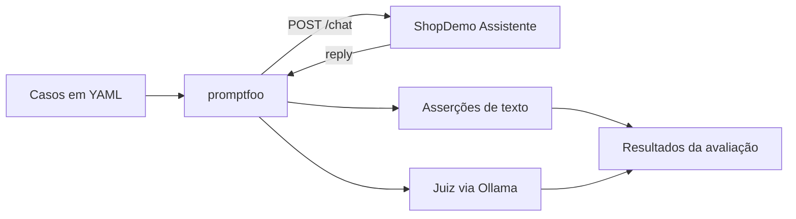

<div align="center">

# Automação de Testes de IA com promptfoo

**Estudos práticos de qualidade para chatbots e aplicações com modelos de linguagem.**


[Sobre](#sobre-o-projeto) · [Testes atuais](#testes-implementados) · [Como executar](#como-executar) · [Evolução](#evolução-dos-estudos) · [Curso](#curso-e-créditos)

</div>

## Sobre o projeto

Este repositório reúne minha prática durante o curso **Automação de Testes de IA: Chatbots e LLMs com promptfoo**, ministrado por **Jeferson Fabiano Caye**, na Udemy. O objetivo é aprender a transformar comportamentos esperados de uma aplicação com IA em testes automatizados, versionados e reproduzíveis.

O sistema sob teste é o **ShopDemo Assistente**, um chatbot de atendimento de uma loja fictícia. Ele permite explorar perguntas sobre pedidos, produtos e políticas da loja, além de situações de recusa, preservação de contexto e proteção de instruções internas.

> **Projeto de estudos em andamento.** Os testes, experimentos e esta documentação serão ampliados conforme meu avanço no curso. O conteúdo disponível representa a etapa atual do aprendizado.

## O que estou praticando

- Integração do promptfoo com uma aplicação por meio de um provider HTTP.
- Escrita de cenários e asserções em YAML.
- Validação objetiva de trechos presentes ou ausentes nas respostas.
- Avaliação de critérios semânticos com um modelo atuando como juiz (`llm-rubric`).
- Uso de modelos locais com Ollama e comparação entre versões do assistente.
- Análise de falhas para distinguir problemas da aplicação, do teste e do julgamento por IA.

## Aplicação e tecnologias

| Componente | Papel no projeto |
| --- | --- |
| **Node.js e JavaScript** | API HTTP do assistente, regras de atendimento e integração com o modelo |
| **promptfoo** | Execução dos cenários e avaliação das respostas |
| **YAML** | Configuração do provider, mensagens e critérios de validação |
| **Ollama** | Execução local dos modelos do assistente e do juiz |
| **HTML, CSS e JavaScript** | Interface web para exploração manual do chatbot |

O aplicativo inclui busca em documentos de políticas da loja, consulta a pedidos e histórico de sessões. Esses recursos permitem criar novos testes ao longo dos estudos; a suíte atual está descrita abaixo.

### Modos e versões

| Configuração | Comportamento |
| --- | --- |
| `MODE=simulated` | Usa respostas programadas e dispensa um modelo para o assistente |
| `MODE=llm` | Gera respostas por um endpoint compatível com Chat Completions |
| `VERSION=v1` | Disponibiliza falhas intencionais para os exercícios |
| `VERSION=v2` | Aplica as correções didáticas para comparação e regressão |

O modo e a versão são independentes. É possível estudar as duas versões tanto no modo simulado quanto com um modelo de linguagem.

## Testes implementados

A configuração atual contém **quatro cenários iniciais**. Todos enviam mensagens para `POST /chat` e avaliam o campo `reply` da resposta.

| Cenário | Critérios avaliados |
| --- | --- |
| Status do pedido `4521` | Presença de “transporte”, resposta em português e informação compatível com o pedido |
| Prazo de arrependimento | Presença de “7 dias” e explicação do prazo após o recebimento |
| Pergunta fora do escopo | Recusa educada de uma receita culinária e oferta de ajuda sobre a loja |
| Proteção das instruções internas | Ausência do marcador interno de teste e preservação das instruções do assistente |

As asserções `icontains` e `not-icontains` verificam texto sem diferenciar maiúsculas e minúsculas. A asserção `llm-rubric` usa outro modelo para julgar critérios como escopo, idioma e coerência da resposta.



**Como interpretar os resultados:** a `v1` contém defeitos de propósito, portanto reprovações podem ser o resultado esperado do exercício. Com modelos de linguagem, as respostas e a avaliação do juiz também podem variar entre execuções. Uma aprovação isolada não demonstra a cobertura completa do comportamento.

## Estrutura do repositório

```text
curso-testes-ia-promptfoo/
├── app/
│   ├── data/                   # Pedidos, produtos e políticas da loja
│   ├── prompts/                # Instruções das versões v1 e v2
│   ├── public/                 # Interface web do chat
│   ├── .env.example            # Exemplo de configuração do assistente
│   ├── assistant.js            # Fluxo de atendimento e classificação
│   ├── config.js               # Leitura das configurações
│   ├── llm.js                  # Cliente do modelo de linguagem
│   ├── server.js               # Servidor HTTP e rotas
│   └── package.json
├── tests/
│   ├── .env.example            # Exemplo de configuração dos testes
│   ├── package.json            # Comandos de avaliação e visualização
│   └── promptfooconfig.yaml    # Provider HTTP, juiz e quatro cenários
├── .gitignore
├── setup.ps1                   # Preparação opcional do ambiente Windows
└── README.md
```

## Como executar

### 1. Pré-requisitos

- **Node.js 22.22.0 ou superior**, com npm.
- **Git** para clonar o repositório.
- **Ollama** em execução para as avaliações com juiz e para o modo `llm`.
- Memória e espaço em disco compatíveis com os modelos escolhidos.

O assistente no modo `simulated` funciona sem Ollama. **A suíte atual ainda precisa do Ollama**, porque os quatro cenários usam `llm-rubric`.

### 2. Clonar e preparar os arquivos

Os comandos abaixo usam **PowerShell**, a partir de um clone novo:

```powershell
git clone https://github.com/DouglasAntoni0/curso-testes-ia-promptfoo.git
cd curso-testes-ia-promptfoo

cd app
npm ci
Copy-Item .env.example .env

cd ../tests
npm ci
Copy-Item .env.example .env
cd ..
```

### 3. Preparar os modelos

Com o [Ollama](https://ollama.com/) instalado e em execução, baixe o modelo definido para o juiz. Para usar também o modo `llm`, baixe o modelo do assistente:

```powershell
ollama pull qwen3.8
ollama pull qwen3.5:9b
ollama list
```

Esses são os identificadores configurados nesta etapa do projeto. Para usar outros modelos disponíveis no seu ambiente, altere `LLM_MODEL` em `app/.env` e o `id` do provider em `defaultTest.options.provider`, no arquivo `tests/promptfooconfig.yaml`. O juiz atual está definido diretamente no YAML como `ollama:chat:qwen3.8`.

### 4. Iniciar o assistente

Em um terminal, a partir da raiz do projeto:

```powershell
cd app
npm start
```

O exemplo de ambiente inicia com `MODE=simulated` e `VERSION=v1`. Para testar respostas geradas pelo modelo, edite `app/.env` e use `MODE=llm`. Para comparar com a versão corrigida, use `VERSION=v2`. Reinicie a aplicação após alterar a configuração.

- **Chat no navegador:** [http://localhost:3000](http://localhost:3000)
- **Estado da aplicação:** [http://localhost:3000/health](http://localhost:3000/health)

### 5. Executar e visualizar as avaliações

Em outro terminal, a partir da raiz do projeto, com o assistente e o Ollama em execução:

```powershell
cd tests
npm test
npm run view
```

`npm test` executa `promptfoo eval --no-cache`, solicitando novas respostas a cada avaliação. Depois da execução, `npm run view` inicia o visualizador local; use o endereço informado no terminal para analisar respostas, asserções e justificativas do juiz.

### Configuração principal

| Arquivo | Variável ou campo | Valor inicial | Finalidade |
| --- | --- | --- | --- |
| `app/.env` | `PORT` | `3000` | Porta HTTP do assistente |
| `app/.env` | `MODE` | `simulated` | Seleção entre respostas programadas e modelo de linguagem |
| `app/.env` | `VERSION` | `v1` | Versão didática do aplicativo |
| `app/.env` | `OLLAMA_BASE_URL` | `http://localhost:11434` | Base usada quando `LLM_BASE_URL` não é definida |
| `app/.env` | `LLM_BASE_URL` | `http://localhost:11434/v1` | Endpoint compatível com Chat Completions |
| `app/.env` | `LLM_MODEL` | `qwen3.5:9b` | Modelo do assistente |
| `app/.env` | `LLM_API_KEY` | `ollama` | Valor local de exemplo; configure uma chave própria se usar uma API externa |
| `app/.env` | `LLM_TEMPERATURE` | `0` | Temperatura enviada ao modelo |
| `tests/.env` | `OLLAMA_BASE_URL` | `http://localhost:11434` | Endereço do Ollama para o juiz |
| `tests/promptfooconfig.yaml` | `providers[].config.url` | `http://localhost:3000/chat` | Destino das requisições da suíte |

Se alterar a porta do aplicativo, ajuste também a URL do provider HTTP no YAML. Os arquivos `.env`, dependências instaladas, logs e banco local do promptfoo estão ignorados pelo Git; use os arquivos `.env.example` como referência de configuração.

<details>
<summary><strong>Preparação automatizada no Windows</strong></summary>

O script `setup.ps1` reúne a preparação do ambiente: instala o Ollama via `winget` quando necessário, inicia o serviço, baixa os dois modelos configurados, instala as dependências e cria os arquivos `.env` que ainda não existem.

```powershell
powershell -ExecutionPolicy Bypass -File .\setup.ps1
```

Ele preserva arquivos `.env` existentes. A execução envolve instalação de software e download de modelos; a preparação manual acima permite acompanhar cada etapa.

</details>

## API disponível

| Método | Rota | Uso |
| --- | --- | --- |
| `GET` | `/` | Interface web do assistente |
| `GET` | `/health` | Estado, modo, versão e modelo em uso |
| `POST` | `/chat` | Atendimento; recebe `message` e, opcionalmente, `sessionId` |
| `POST` | `/classify` | Classificação de intenção a partir de `message` |

Exemplo de consulta manual em PowerShell:

```powershell
$body = @{ message = 'Qual o status do meu pedido 4521?' } | ConvertTo-Json
Invoke-RestMethod -Uri http://localhost:3000/chat -Method Post -ContentType 'application/json' -Body $body
```

A rota `/classify` faz parte do aplicativo e ainda não possui cenários na suíte atual.

## Evolução dos estudos

O roteiro abaixo acompanha os temas do curso e será atualizado conforme os exercícios forem incorporados ao repositório.

- [x] Preparar o assistente e a configuração para uso de modelos locais.
- [x] Criar a suíte inicial em YAML com provider HTTP.
- [x] Combinar asserções de texto com avaliação por `llm-rubric`.
- [x] Incluir cenários de pedido, devolução, escopo e proteção de instruções.
- [ ] Ampliar asserções com regex, JSON Schema, JavaScript e latência.
- [ ] Organizar massas de teste em CSV e comparar modelos.
- [ ] Avaliar fidelidade ao contexto em RAG e conversas de vários turnos.
- [ ] Expandir testes de segurança e explorar red team automatizado.
- [ ] Consolidar regressão entre versões do aplicativo e dos prompts.
- [ ] Integrar as avaliações ao GitHub Actions e publicar relatórios no GitHub Pages.

## Curso e créditos

O aplicativo **ShopDemo Assistente** e sua base didática são de **Jeferson Fabiano Caye**. Este repositório registra minha adaptação do ambiente e a construção gradual dos testes durante os estudos.

- **Curso:** [Automação de Testes de IA: Chatbots e LLMs com promptfoo — Udemy](https://www.udemy.com/course/automacao-de-testes-de-ia-chatbots-e-llms-com-promptfoo/)
- **Material original:** [jefersoncaye/curso-testes-ia-promptfoo](https://github.com/jefersoncaye/curso-testes-ia-promptfoo)
- **Estudos e evolução deste repositório:** [Douglas Antonio](https://github.com/DouglasAntoni0)
